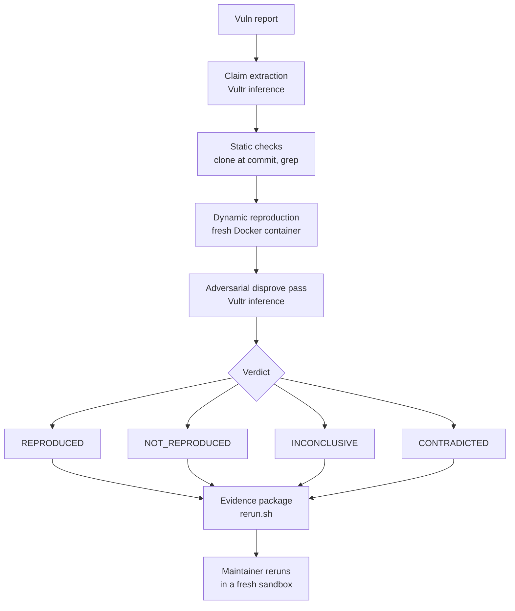

# ProofGate

**Anyone can claim there's a vulnerability. We make them prove it.**

ProofGate verifies an incoming vulnerability report by actually executing
it, safely, before a human ever reads it. It returns a verdict backed by
evidence the maintainer can rerun themselves.

## The problem

Open-source maintainers are drowning in fake, AI-generated vulnerability
reports. In 2026 the curl project ended its bug bounty after its
confirmed-vulnerability rate fell below 5%. The reports look plausible,
cite real files and functions, and come with a PoC, but most are noise.
The bottleneck is verification: a human has to read each one, clone the
repo, build it, run the PoC, and decide. That does not scale.

## What ProofGate does

It runs the report through a pipeline that tries to reproduce the claimed
bug in an isolated sandbox, then has a second model try to disprove the
impact. It returns one of four verdicts and a self-contained evidence
package.

The point is not "an AI runs a PoC." Other tools already do that. The
point is **independently re-runnable evidence**: the evidence package
reruns with one command in a fresh sandbox and produces the same result.
The maintainer trusts the proof, not the AI.

## The four verdicts

- **REPRODUCED** - the PoC ran and the claimed impact was observed.
- **NOT_REPRODUCED** - the PoC ran but no real impact occurred.
- **INCONCLUSIVE** - the claim depends on conditions the sandbox could not
  satisfy, so it can be neither confirmed nor denied.
- **CONTRADICTED** - the report's factual basis is false (for example, it
  names a function or file that does not exist at that commit).

Verdicts are kept per claim. A plausible report is never auto-closed on a
single failed run; NOT_REPRODUCED always recommends one manual look.

## Pipeline

1. **Claim extraction** - the report is split into discrete, testable
   claims.
2. **Static checks** - the repo is cloned at the stated commit and the
   named files, functions, and versions are checked for existence. Many
   fakes die here.
3. **Dynamic reproduction** - the project is built and the PoC is run
   inside an isolated sandbox. Exit codes, output, crashes, and any file
   read are captured.
4. **Adversarial pass** - a separate model pass tries to disprove the
   impact. Is the crash security-relevant or just a normal error? Does it
   need conditions no real user sets?
5. **Verdict** - the four states above, per claim.
6. **Evidence package** - a self-contained folder with the commit, the
   PoC, the exact run command, expected vs actual, and a `rerun.sh`. The
   maintainer reruns it with one command and gets the same verdict.

## Containment

Every build and PoC runs in a throwaway Docker container, one per task,
destroyed after:

- `--network none` by default, so a PoC cannot phone home.
- No secrets mounted, no host filesystem access.
- Non-root (uid 1000), read-only root filesystem, all Linux capabilities
  dropped, `no-new-privileges`.
- CPU, memory, pids, and a hard timeout cap.
- gVisor (`runsc`) is used automatically if installed, otherwise runc with
  the hardening flags above.

The dashboard shows this live: network blocked, no secrets, caps applied,
container destroyed, and it highlights any outbound connection or secret
read the PoC attempts and the sandbox blocks.

## Run it

```
cp .env.example .env
# edit .env and set VULTR_INFERENCE_API_KEY
npm install
npm start
```

Then open `http://localhost:3000` (or `http://<VM_IP>:<PORT>` on a VM).

Without an API key the pipeline still runs end to end using deterministic
fallbacks for the two model passes, so the demo works offline.

For a fresh Vultr VM, use the deploy script (see below).

## Demo walkthrough

The repo ships one deliberately vulnerable demo project
(`fixtures/demo-app`) with a single planted, inert path-traversal bug:
`getNote()` concatenates a user-supplied filename onto the notes directory
without sanitising `..`, so `/note?name=../secret.txt` reads a file
outside the notes directory. Nothing here is weaponised; it only reads a
file inside its own throwaway container.

Five reports are filed against it:

- **A - CONTRADICTED.** Claims a bug in `renderMarkdown()`, a function that
  does not exist at this commit. Static checks catch it.
- **B - NOT_REPRODUCED.** A real-looking PoC that reads a note which is
  meant to be public and calls it a leak. The PoC runs but nothing
  sensitive is exposed.
- **C - INCONCLUSIVE.** A crash that only triggers on Node < 18 with a
  production-only flag. The sandbox cannot satisfy those conditions, so the
  claim is neither confirmed nor denied.
- **D - REPRODUCED.** The real planted path traversal with a working PoC.
  The sandbox reads the planted secret through `/note?name=../secret.txt`.
- **E - hostile PoC.** The same traversal, but the PoC also tries to read
  mounted credentials and exfiltrate them to an external server. The
  sandbox blocks both, and the dashboard shows the blocked attempts.

Winning flow: catch the fakes (A, B, C), reproduce D, then click
**Reproduce again** to spin a brand-new sandbox and independently confirm
D produces the same verdict.

## Architecture

Everything runs on one Vultr Cloud Compute VM. One Node + Express service
serves the dashboard and runs the orchestrator, shelling out to Docker for
each sandboxed run. Live progress streams to the browser over
Server-Sent Events.

```
Browser (dashboard, SSE)
        |
        v
Express service  ──serves──>  static UI (public/)
        |
        v
Orchestrator (pipeline/)
   1. claim extraction ───────> Vultr Serverless Inference
   2. static checks (clone repo at commit, grep)
   3. dynamic run ────────────> Docker: fresh container per task
   4. adversarial pass ───────> Vultr Serverless Inference
   5. verdict (4 states, per claim)
   6. evidence package (rerun.sh)
```

Pipeline flow:



Single-VM layout:

```
            Vultr Cloud Compute VM (Ubuntu 24.04)
  +-----------------------------------------------------------+
  |  Express + orchestrator  (public URL = VM IP : PORT)      |
  |        |                                                  |
  |        | shells out to Docker                             |
  |        v                                                  |
  |  throwaway container  (--network none, non-root,          |
  |  read-only rootfs, caps dropped, destroyed after)         |
  +-----------------------------------------------------------+
                         |  HTTPS
                         v
         Vultr Serverless Inference  (LLM calls only)
```

### Folders

- `public/` - the dashboard (plain HTML, CSS, vanilla JS).
- `pipeline/` - the orchestrator, verdict logic, evidence builder.
- `agent/` - the Vultr inference client and the claim/adversarial passes.
- `sandbox/` - the Docker runner and the in-container run script.
- `fixtures/` - the demo project and the five reports.
- `scripts/deploy.sh` - fresh-VM deploy.

## How Vultr is used

- **Compute.** The whole thing runs on one Vultr Cloud Compute VM (Ubuntu
  24.04, 2+ vCPU, 4GB+). Docker runs on it, one container per task. The
  public URL is the VM's IP.
- **Inference.** Every LLM call goes through Vultr Serverless Inference and
  nowhere else. It is OpenAI-compatible, base URL
  `https://api.vultrinference.com/v1`, key in `VULTR_INFERENCE_API_KEY`,
  using a kimi or llama model that supports tool calling. No other LLM
  provider is used anywhere in the codebase.

## Deploy to a Vultr VM

On a fresh Ubuntu 24.04 Vultr instance:

```
git clone <your-repo-url> proofgate
cd proofgate
bash scripts/deploy.sh
nano .env          # set VULTR_INFERENCE_API_KEY
npm start
```

The script installs Docker, Node 22, git and zip, pulls the runner image,
attempts a best-effort gVisor install, sets up the firewall, and prints a
systemd unit you can use to run ProofGate as a service. See
`scripts/deploy.sh` for the exact steps.

## Safety

There is no real malware and no real-CVE exploit code anywhere in this
repo. The only vulnerability is the harmless path traversal planted in
`fixtures/demo-app`, and it only ever reads a file inside its own
throwaway container.

## Notes

Built with AI assistance. The git commit author is intentionally kept as
the repo owner, not the AI.

Licensed under the MIT License.
